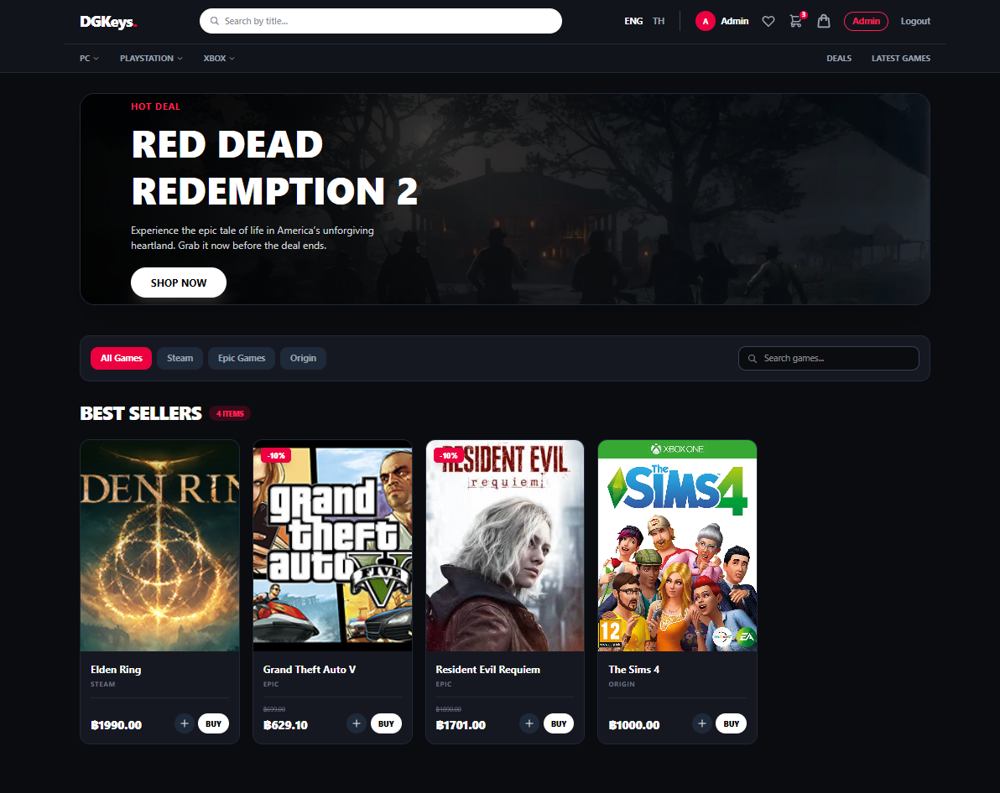
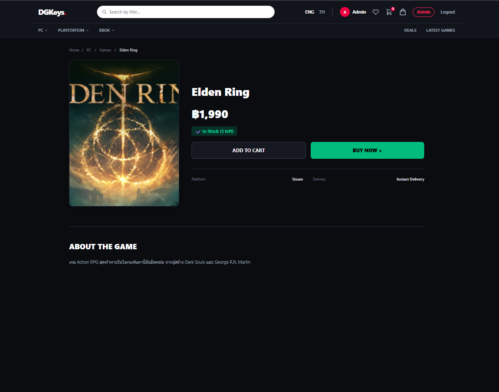
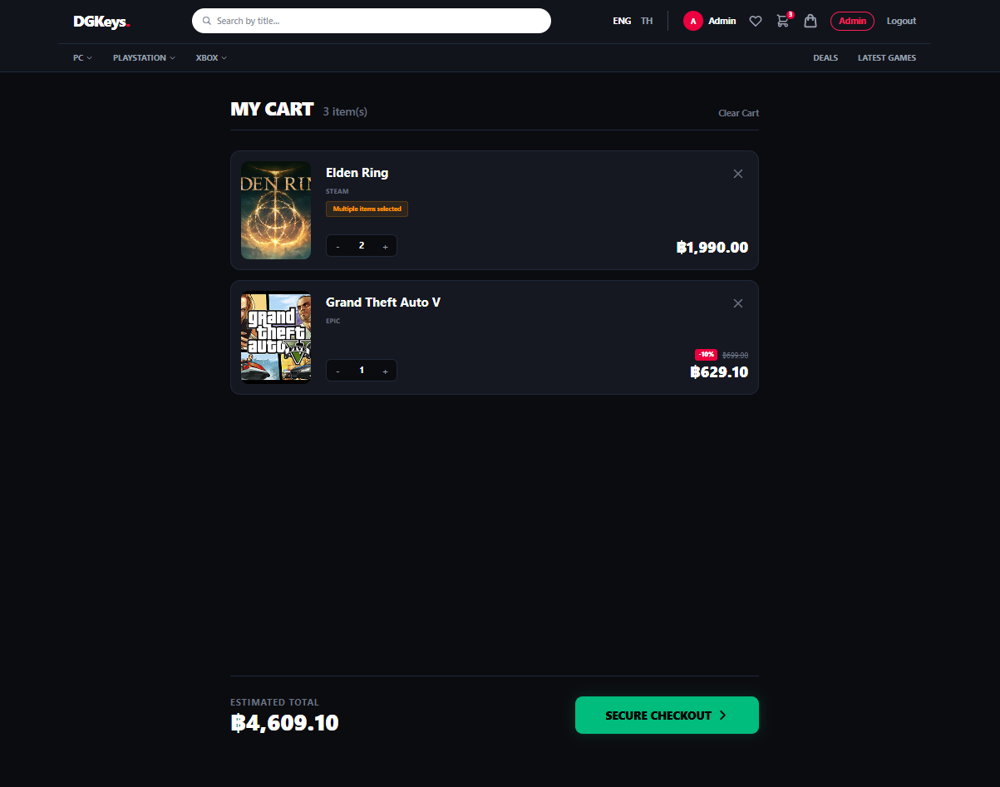
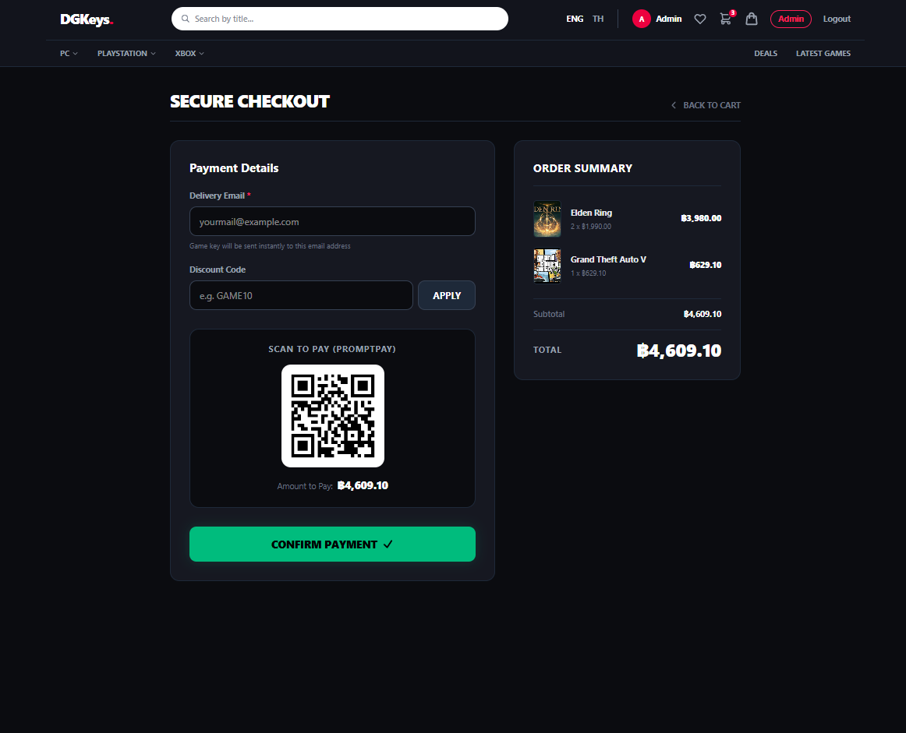
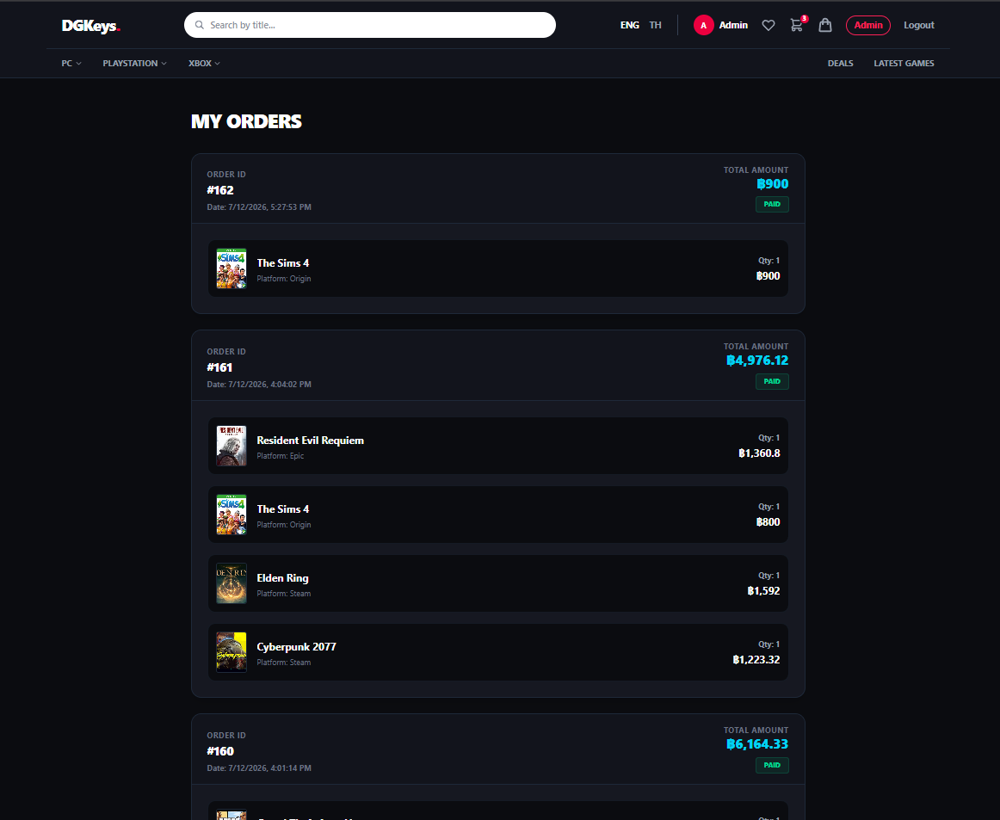
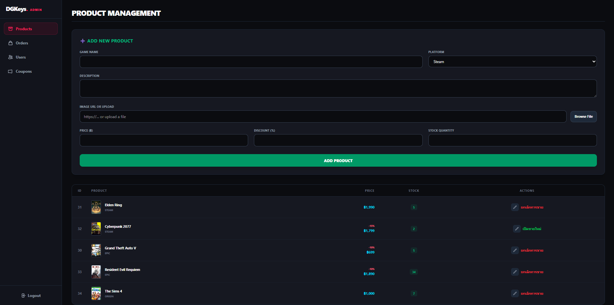
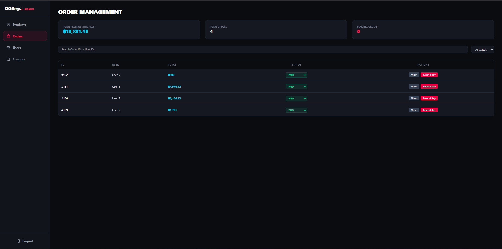
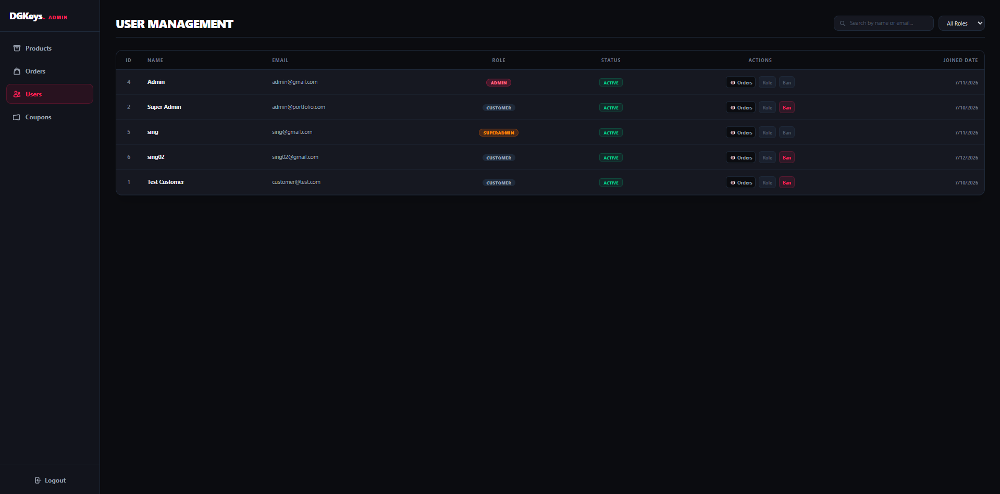
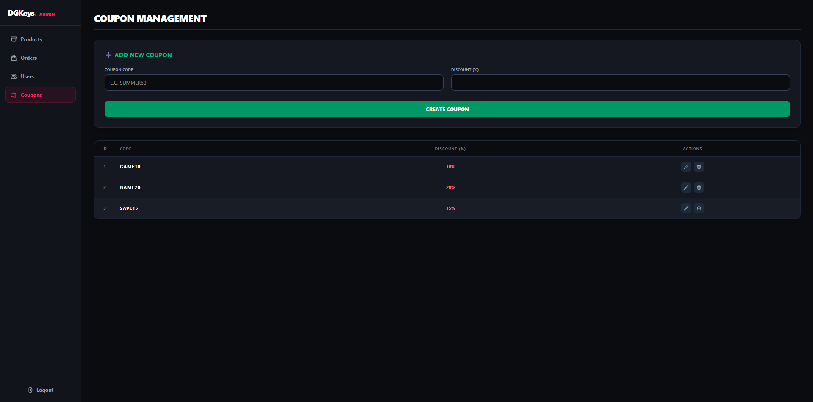

# DGKeys — Digital Game Key Storefront & Order System

[](https://github.com/sing198/OMS/actions/workflows/backend-ci.yml)

**React · Vite · Tailwind CSS · Go (Gin, GORM) · PostgreSQL · JWT**

**[Live Demo](https://oms-lemon.vercel.app/) · [Architecture & Case Study](https://thanaphat-ku.is-a.dev/#case-study-OMS) · [Author Portfolio](https://thanaphat-ku.is-a.dev)**

DGKeys is a full-stack digital game key storefront with a React frontend, a Go (Gin) REST API, and a PostgreSQL database engineered for safe concurrent checkouts.

Customers can browse games, keep a cart, apply coupons, and view their orders and delivered game keys. Admins can manage products, upload images, update order statuses, expire abandoned pending orders, and suspend accounts. Super admins can also change user roles and read the admin activity log. The interface includes Thai and English translations.

Checkout supports both **Instant Payment Simulation** (which immediately confirms payment and generates unique `DGK-XXXX-XXXX-XXXX-XXXX` digital activation keys) and **Reserve & Pay Later** (which reserves stock for 30 minutes). An HMAC-SHA256 verified `/webhooks/payment` endpoint is also included for external payment gateway callbacks, along with an automated background job that releases stock from abandoned pending orders.

## Running locally

You need Go 1.26.5 or later, Node.js 24 (the version in `.nvmrc`), and a PostgreSQL database. Supabase works too if you prefer a hosted database.

```bash
git clone https://github.com/sing198/OMS.git
cd OMS
```

### Backend

```bash
cd oms-backend
cp .env.example .env
```

Set `DATABASE_URL` to your database connection string. Generate a secret with the command below and use its output as `JWT_SECRET`:

```bash
openssl rand -hex 32
```

The server requires a secret of at least 32 bytes. It creates or updates the database tables on startup, so use a development database when trying it out.

```bash
go run .
```

The API runs on `http://localhost:8080`. You can check it at `/ping`. Uploaded images are saved in `oms-backend/uploads/`.

### Frontend

Open another terminal from the repository root:

```bash
cd oms-frontend
nvm use
cp .env.example .env
npm ci
npm run dev
```

If you don't use nvm, install Node.js 24 before running these commands and skip `nvm use`.

Open `http://localhost:5173`. The frontend uses `VITE_API_URL` from `.env`, which defaults to `http://localhost:8080`.

New accounts have the `customer` role. To try the admin pages, register an account and change that account's role to `superadmin` directly in your development database. There is no seeded admin account.

## Code layout

- `oms-backend/main.go` — models, authentication, and most API routes.
- `oms-backend/orders.go` — order validation, pricing, and stock reservation.
- `oms-backend/security_test.go` — authentication and order unit/regression tests.
- `oms-backend/checkout_integration_test.go` — concurrent PostgreSQL checkout integration tests (50-buyer race for the last key, oversell prevention, opposite-order cart deadlock prevention, and multi-item rollback).
- `oms-frontend/src/pages/` — storefront and admin pages.
- `oms-frontend/src/locales/` — Thai and English translation files.
- `screenshots/` — screenshots of the application.

The frontend uses React, Vite, Tailwind CSS, Axios, and i18next. The backend uses Gin for HTTP routes and GORM for database access.

Passwords are hashed with bcrypt. Authentication uses JWTs, but account status and roles are read from the database on each authenticated request, so a ban or role change applies to existing sessions.

Order creation runs inside a database transaction. Product rows are locked in ID order before stock is checked and reduced. If a write or the commit fails, the API returns an error instead of confirming the order.

## Checks

From `oms-backend/`:

```bash
go test -race ./...
go vet ./...
```

The automated test suite covers invalid quantities, unavailable stock, transaction failures, account permission enforcement, and real PostgreSQL concurrency (`TEST_DATABASE_URL="postgres://.../oms_test?sslmode=disable" go test -race -v ./...`), which runs automatically on every push in [GitHub Actions CI](.github/workflows/backend-ci.yml).

From `oms-frontend/`:

```bash
npm run build
npm run lint
```

Both the production frontend bundle (`npm run build`) and backend test suite (`go test -race ./...`) pass.

## Key Features

- **Concurrent-Safe Stock Reservation & Automatic Rollback** — Row-level `FOR UPDATE` locking in deterministic product ID order prevents overselling and deadlocks under high concurrency.
- **Instant Digital Key Delivery & Webhook Verification** — Orders transitioning to `paid` (via instant checkout, customer payment, admin confirmation, or HMAC-SHA256 verified `POST /webhooks/payment`) automatically generate and attach digital activation keys (`DGK-XXXX-XXXX-XXXX-XXXX`) to each order item.
- **Scheduled Pending Order Expiry & Stock Restoration** — A background worker automatically cancels abandoned `pending` orders older than `ORDER_EXPIRY_MINUTES` (default 30 minutes) and restores reserved product stock safely inside a transaction.

## Screenshots



<details>
<summary>Storefront pages</summary>

### Product details



### Cart



### Checkout (earlier version)



### Order history



</details>

<details>
<summary>Admin pages</summary>

### Products



### Orders



### Users



### Coupons



</details>
